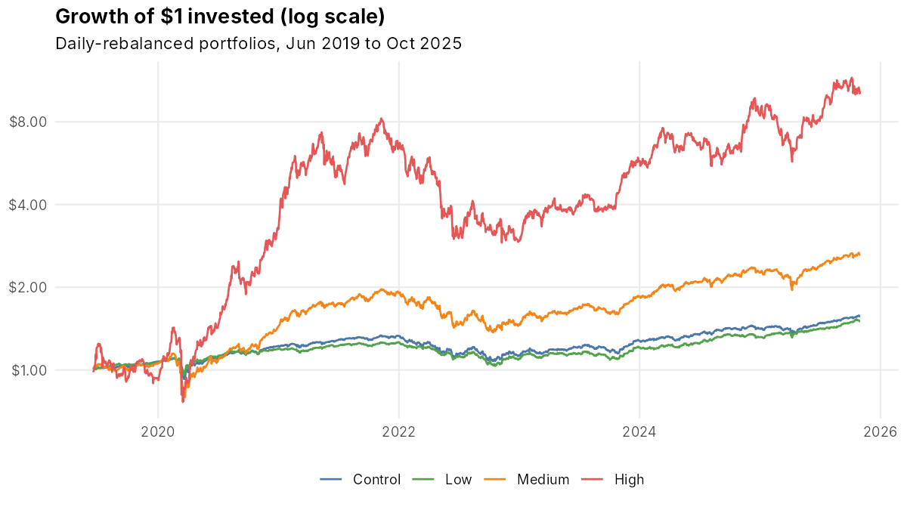
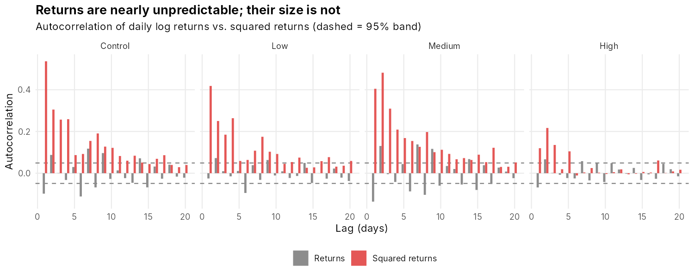
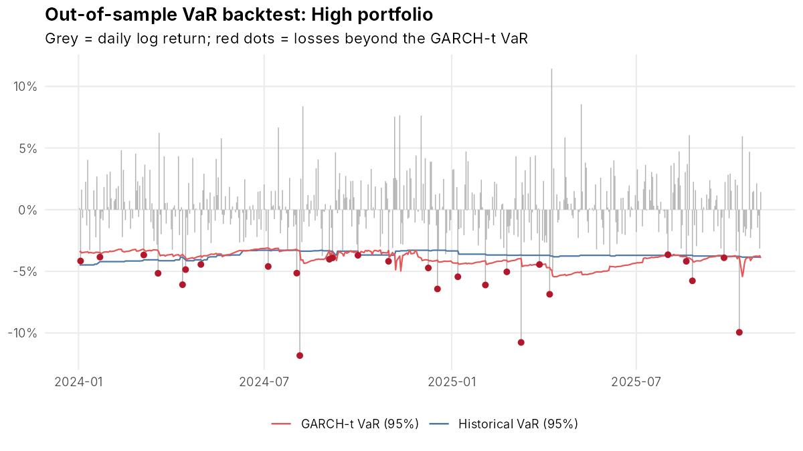
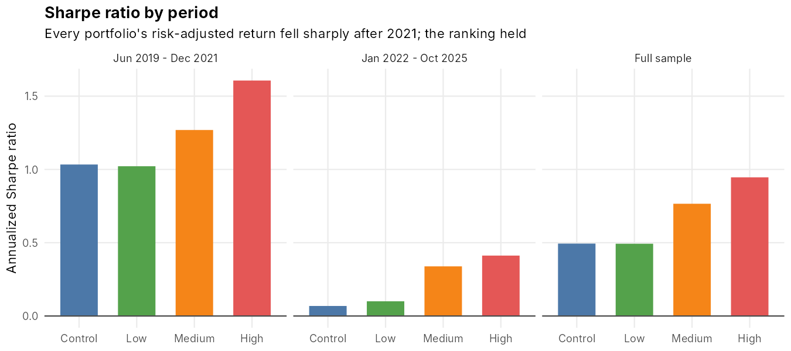
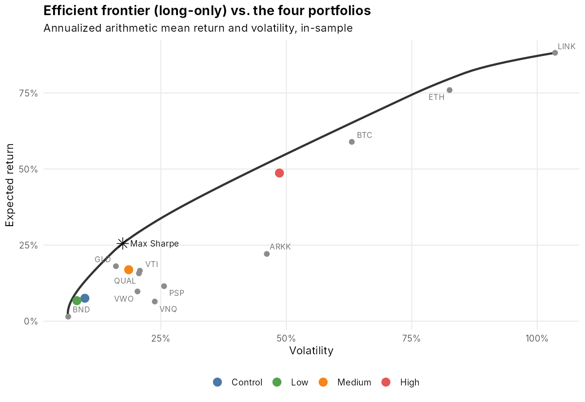

# Evaluating Portfolio Risk with Time-Series Methods and Modern Portfolio Theory

**Allan Ross** · B.S. Statistics, Colorado Mesa University · Senior Capstone (2025), extended 2026

How much risk do you actually take on when you move from a conservative portfolio to an aggressive, crypto-heavy one, and do the standard risk models measure that risk correctly? This project builds four portfolios from 11 real assets, measures their risk five different ways, and tests the risk models out of sample on 2024–2025 data they never saw.



## Key findings

Data: daily adjusted prices, June 2019 – October 2025 (1,604 daily returns), from Yahoo Finance. Risk-free rate: 3-month U.S. Treasury yield (FRED `DGS3MO`).

| Portfolio | Annual return | Volatility | Sharpe | Sortino | Beta | Max drawdown | 10-day 95% VaR on $1M |
|---|---|---|---|---|---|---|---|
| Control (40/60 stocks/bonds) | 7.3% | 9.9% | 0.49 | 0.68 | 0.44 | −19.4% | $29,067 |
| Low | 6.6% | 8.3% | 0.49 | 0.68 | 0.29 | −18.1% | $24,283 |
| Medium | 16.4% | 18.6% | 0.77 | 1.05 | 0.82 | −30.7% | $53,377 |
| High (55% crypto) | 44.2% | 48.6% | 0.95 | 1.34 | 1.29 | −64.7% | $132,398 |

*VaR shown is the Monte Carlo (multivariate Student-t) estimate. Full tables: [`output/tables/`](output/tables).*

1. **Daily returns are close to unpredictable, but their size is not.** ARIMA forecasts were no better than simply using the average return on the 2024–2025 test data; their errors were 0.7–1.1% larger for three of the four portfolios and only 0.08% smaller for High. Squared returns, by contrast, are strongly autocorrelated (ARCH LM test p < 10⁻²¹ for every portfolio), which is the volatility clustering GARCH is built for.
   

2. **GARCH is the only VaR model that passed every backtest.** Historical and normal-distribution VaR produced about the right *number* of exceptions, but the exceptions bunched together in volatile stretches: the Christoffersen independence test rejected them at the 5% level for the Control, Low and Medium portfolios. GARCH(1,1) with Student-t errors adapts to current volatility and passed both the Kupiec and Christoffersen tests for all four portfolios at 95%.
   

3. **The High portfolio's edge is mostly one period.** Its Sharpe ratio was 1.61 from mid-2019 to 2021 but 0.41 from 2022 onward, with a −57% drawdown along the way. Every portfolio's risk-adjusted return fell sharply after 2021 (rate hikes hit stocks and bonds at once); the ranking held.
   

4. **The "optimal" portfolio is a hindsight artifact.** The in-sample maximum-Sharpe portfolio is 69% gold, 17% VTI and 14% crypto, simply because gold had an exceptional run. Efficient frontiers built on past average returns describe history, not what to buy.
   

5. **Normal-distribution VaR understates tail risk.** At 99% confidence, historical 10-day VaR is 17–31% larger than the normal-distribution estimate for the Control, Low and Medium portfolios. Excess kurtosis of daily returns ranges from 7 (High) to 23 (Control), driven by March 2020.

## Methods

| Step | Script | What it does |
|---|---|---|
| 1 | `R/01_get_data.R` | Downloads adjusted prices (quantmod/Yahoo) and the Treasury yield (FRED) |
| 2 | `R/02_returns.R` | Aligns stock and crypto calendars, builds daily-rebalanced portfolio returns, correlation matrix |
| 3 | `R/03_risk_metrics.R` | CAGR, volatility, Sharpe, Sortino, beta, Treynor, max drawdown, skewness, kurtosis, with formulas written out |
| 4 | `R/04_time_series.R` | ADF stationarity tests, Ljung-Box and ARCH LM tests, auto.arima with an out-of-sample forecast comparison |
| 5 | `R/05_garch.R` | GARCH(1,1) with Student-t errors; persistence, half-life and conditional volatility |
| 6 | `R/06_var_es.R` | 1- and 10-day VaR and Expected Shortfall at 95%/99%: historical, parametric and Monte Carlo |
| 7 | `R/07_backtest.R` | Rolling 500-day out-of-sample VaR backtest (2024–2025), Kupiec and Christoffersen tests |
| 8 | `R/08_efficient_frontier.R` | Long-only efficient frontier by quadratic programming; max-Sharpe portfolio |
| 9 | `R/09_robustness.R` | Sub-period analysis and rebalancing sensitivity (daily, monthly, buy-and-hold) |

**Design choices worth knowing**

- *Calendar alignment.* Crypto trades 7 days a week and stocks 5. The analysis keeps U.S. trading days only and uses crypto's latest close, so weekend crypto moves land in Monday's return instead of creating false zero-return days for stocks.
- *Rebalancing.* Portfolios are rebalanced to target weights daily. Buy-and-hold would have returned more for Control, Low and Medium (8.2%, 7.6%, 18.9% a year) and less for High (36.4%), because rebalancing kept trimming crypto during its run-ups. See `rebalancing_sensitivity.csv`.
- *No look-ahead in the backtest.* Each day's VaR uses only the previous 500 days. GARCH parameters are re-estimated monthly and the variance is updated daily.
- *Transparent metrics.* Ratios are computed from their formulas rather than package calls, so each number can be checked by hand.

**Limitations.** One 6.4-year sample that includes a pandemic crash and a crypto boom; no transaction costs or taxes; Yahoo crypto closes are at midnight UTC while U.S. equities close at 4 p.m. ET; asset selection was made with knowledge of how these assets performed.

## Reproduce

Requires R ≥ 4.2.

```r
install.packages(c("quantmod", "xts", "zoo", "forecast", "tseries", "fGarch",
                   "quadprog", "ggplot2", "ggrepel", "dplyr", "tidyr", "scales"))
```

```bash
Rscript run_all.R            # uses data/prices.csv (included)
Rscript run_all.R --refresh  # re-downloads prices first
```

Runs in under a minute. Outputs go to `output/figures` and `output/tables`.

## Repository layout

```
├── run_all.R          # runs every step in order
├── R/                 # one script per analysis step
├── data/              # prices.csv, risk_free.csv (raw inputs)
└── output/
    ├── figures/       # 10 charts
    └── tables/        # results as CSV
```
